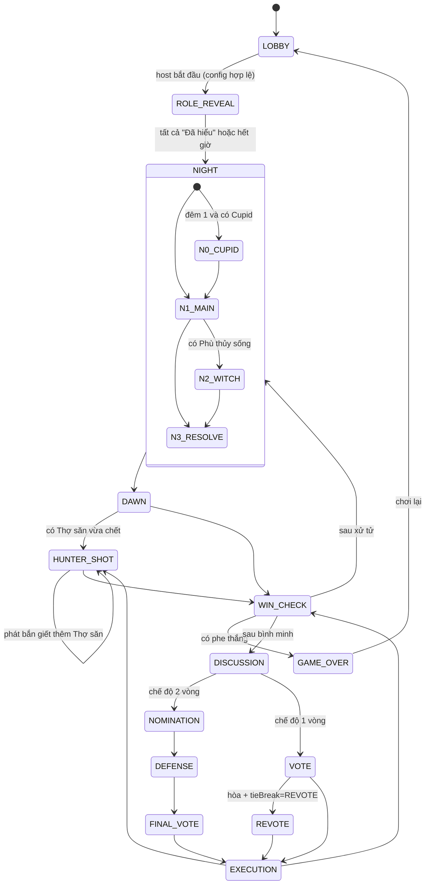

# KẾ HOẠCH CHI TIẾT — GAME MA SÓI TRÊN WEB

> Phiên bản tài liệu: 1.0 · Trạng thái: Bản nháp để chốt
> Phạm vi: Game Ma Sói nhiều người chơi trên trình duyệt, **không có chat và không có voice trong ứng dụng**.

---

## Mục lục

0. [Tóm tắt](#0-tóm-tắt)
1. [Phạm vi](#1-phạm-vi)
2. [Giả định và các quyết định cần chốt](#2-giả-định-và-các-quyết-định-cần-chốt)
3. [Luật chơi chi tiết](#3-luật-chơi-chi-tiết)
4. [Trải nghiệm người dùng (UX/UI)](#4-trải-nghiệm-người-dùng-uxui)
5. [Kiến trúc kỹ thuật](#5-kiến-trúc-kỹ-thuật)
6. [Mô hình dữ liệu](#6-mô-hình-dữ-liệu)
7. [Giao thức realtime (Socket events)](#7-giao-thức-realtime-socket-events)
8. [Bảo mật và chống gian lận](#8-bảo-mật-và-chống-gian-lận)
9. [Các trường hợp biên (edge cases)](#9-các-trường-hợp-biên-edge-cases)
10. [Kiểm thử](#10-kiểm-thử)
11. [Triển khai và vận hành](#11-triển-khai-và-vận-hành)
12. [Lộ trình phát triển (milestones)](#12-lộ-trình-phát-triển-milestones)
13. [Backlog sau MVP](#13-backlog-sau-mvp)
14. [Rủi ro và cách giảm thiểu](#14-rủi-ro-và-cách-giảm-thiểu)
15. [Định nghĩa "hoàn thành" (Definition of Done)](#15-định-nghĩa-hoàn-thành-definition-of-done)
16. [Phụ lục](#16-phụ-lục)

---

## 0. Tóm tắt

**Ý tưởng cốt lõi:** Ứng dụng web đóng vai **quản trò tự động**. Mỗi người chơi mở game trên điện thoại/máy tính của mình, vào chung một phòng bằng mã phòng hoặc QR. App chia vai bí mật, điều khiển ngày/đêm, nhận hành động ban đêm, tổ chức bỏ phiếu, tính kết quả và công bố người thắng.

**Không có chat/voice** → phần thảo luận diễn ra **bên ngoài app**:
- Chơi **cùng phòng** (ngồi chung một chỗ, mỗi người cầm điện thoại) — trường hợp sử dụng chính.
- Chơi **từ xa** qua một kênh gọi bên ngoài (Discord, Zalo, Google Meet…) — app vẫn hoạt động y hệt.

App hỗ trợ thảo luận bằng các công cụ **không phải chat**: đồng hồ đếm ngược, thứ tự lượt nói, "giơ tay xin nói", ghi chú cá nhân, bỏ phiếu.

**Nguyên tắc thiết kế:**
1. **Server quyết định tất cả** (server-authoritative). Client chỉ hiển thị và gửi ý định.
2. **Mỗi người chỉ nhận đúng thông tin mình được biết** — không bao giờ gửi vai của người khác xuống client.
3. **Game engine là code thuần** (không I/O, không mạng) → test dễ, phát lại được ván đấu.
4. **Mobile-first**, thao tác một tay, chữ to, chống nhìn trộm màn hình.
5. **Vai trò dạng plugin** → thêm vai mới không phải sửa lõi.

---

## 1. Phạm vi

### 1.1 Có trong sản phẩm

| Nhóm | Tính năng |
|---|---|
| Phòng chơi | Tạo phòng, mã phòng 5 ký tự, link + QR mời, vào phòng bằng nickname, đổi avatar, sẵn sàng, chủ phòng kick/chuyển quyền |
| Cấu hình | Chọn bộ vai, số lượng mỗi vai, gợi ý bộ vai theo số người, thước đo cân bằng, thời gian từng pha, các luật tùy chọn |
| Gameplay | Chia vai ngẫu nhiên, xem vai bí mật, đêm/ngày tự động, hành động đêm, công bố người chết, thảo luận có đếm giờ, bỏ phiếu, xử tử, kích hoạt kỹ năng khi chết, kiểm tra thắng thua |
| Hỗ trợ thảo luận (không chat) | Đếm giờ thảo luận, thảo luận theo lượt, giơ tay xin nói, "sẵn sàng bỏ phiếu", ghi chú/đánh dấu nghi ngờ cá nhân |
| Sau ván | Màn hình kết quả, lật toàn bộ vai, dòng thời gian ván đấu, chơi lại cùng phòng |
| Kỹ thuật | Kết nối lại khi rớt mạng, chủ phòng điều khiển (tạm dừng/bỏ qua/gia hạn), hiệu ứng âm thanh, giao diện sáng/tối theo ngày/đêm |

### 1.2 KHÔNG có (theo yêu cầu hoặc để sau)

- ❌ Chat chữ trong app (kể cả chat riêng của Sói).
- ❌ Voice/video call trong app.
- ❌ Emoji/reaction công khai (tránh biến thành kênh chat trá hình).
- ⏳ Tài khoản, bảng xếp hạng, lịch sử dài hạn — để giai đoạn sau (MVP dùng nickname ẩn danh).
- ⏳ Ghép trận ngẫu nhiên với người lạ (matchmaking) — để sau, vì không có voice thì chơi với người lạ rất khó.
- ⏳ Bot AI chơi thay người — chỉ dùng bot ngẫu nhiên để test.

---

## 2. Giả định và các quyết định cần chốt

Các mục dưới đây đã có **lựa chọn mặc định** để bắt đầu làm ngay; có thể đổi trước khi vào milestone tương ứng.

| # | Câu hỏi | Mặc định đề xuất | Phương án khác |
|---|---|---|---|
| D1 | Bối cảnh chơi chính | Cùng phòng, mỗi người 1 thiết bị | Từ xa qua voice ngoài (vẫn hỗ trợ) |
| D2 | Có quản trò người thật không? | Không — app là quản trò | Thêm "chế độ quản trò" (người host chỉ điều khiển, không chơi) ở giai đoạn sau |
| D3 | Tài khoản | Không cần, nickname + token ẩn danh | Đăng nhập Google ở giai đoạn sau |
| D4 | Số người mỗi phòng | 5–20 | 4–24 |
| D5 | Sói bàn bạc thế nào khi không có chat? | Mỗi Sói chọn mục tiêu, các Sói khác thấy lựa chọn của nhau theo thời gian thực, đa số thắng | Chỉ Sói đầu đàn quyết định |
| D6 | Người chết có xem được toàn bộ vai không? | Có (tùy chọn, mặc định bật) | Tắt khi chơi cùng phòng nếu sợ lộ qua nét mặt |
| D7 | Công bố vai của người chết | Có | Không công bố (khó hơn) |
| D8 | Ngôn ngữ | Tiếng Việt | Thêm tiếng Anh (cấu trúc i18n có sẵn từ đầu) |
| D9 | Tiền tệ hóa | Không | Quảng cáo/skin — không nằm trong kế hoạch này |
| D10 | Hình minh họa lá bài | Tự vẽ/đặt vẽ minh họa gốc, MVP dùng icon + màu | — |

---

## 3. Luật chơi chi tiết

### 3.1 Vòng chơi tổng quát

```
Phòng chờ → Chia vai → Xem vai
   → ĐÊM 1 → BÌNH MINH (công bố) → NGÀY 1 (thảo luận → bỏ phiếu → xử tử)
   → ĐÊM 2 → BÌNH MINH → NGÀY 2 → ...
   → (bất kỳ lúc nào có phe thắng) → KẾT THÚC
```

Kiểm tra thắng/thua diễn ra **sau mỗi đợt có người chết**: sau bình minh, sau xử tử, sau phát súng của Thợ săn.

### 3.2 Các phe và điều kiện thắng

| Phe | Thành viên | Điều kiện thắng |
|---|---|---|
| **Dân làng** | Dân làng và mọi vai phe dân | Tất cả Sói (kể cả Sói nằm trong cặp đôi) đã chết |
| **Ma sói** | Các loại Sói, Kẻ phản bội | Số Sói còn sống **≥** số người còn sống không phải Sói (tính cả Kẻ phản bội vào phe không-Sói khi đếm) |
| **Cặp đôi khác phe** | 2 người được Cupid ghép nếu khác phe | Chỉ còn đúng 2 người họ sống sót |
| **Kẻ chán đời** (độc lập) | Kẻ chán đời | Bị dân làng **treo cổ** ban ngày |

**Thứ tự ưu tiên khi nhiều điều kiện cùng đúng một lúc:**
1. Kẻ chán đời bị treo cổ → Kẻ chán đời thắng ngay (ván kết thúc — tùy chọn "ván tiếp tục" để sau).
2. Cặp đôi khác phe là 2 người cuối cùng → Cặp đôi thắng.
3. Không còn Sói → Dân làng thắng.
4. Sói ≥ phần còn lại → Sói thắng.
5. Không còn ai sống → Hòa.

> Ghi chú: Sói nằm trong cặp đôi khác phe vẫn đi cắn cùng bầy Sói ban đêm, nhưng **không được tính** vào số Sói khi xét điều kiện thắng của phe Sói (vì người đó không còn thắng cùng phe Sói). Đây là luật cần playtest — để thành tùy chọn cấu hình.

### 3.3 Danh sách vai trò

Ký hiệu: 🟢 MVP · 🟡 Giai đoạn 2 · 🔵 Giai đoạn 3

#### Phe Dân làng

| Vai | GĐ | Hành động | Luật chi tiết | Tiên tri thấy là |
|---|---|---|---|---|
| **Dân làng** | 🟢 | Không có (làm "nhiệm vụ giả" ban đêm — xem 4.3) | Chỉ thảo luận và bỏ phiếu | Không phải Sói |
| **Tiên tri** | 🟢 | Mỗi đêm soi 1 người | Nhận kết quả "Sói / Không phải Sói" ngay sau khi chọn. Không soi chính mình. Có thể soi lại người đã soi (tùy chọn chặn) | Không phải Sói |
| **Bảo vệ** | 🟢 | Mỗi đêm bảo vệ 1 người | Chặn **vết cắn của Sói** (không chặn thuốc độc, không chặn súng). Không được bảo vệ cùng một người 2 đêm liên tiếp. Bảo vệ chính mình: tùy chọn (mặc định cho phép) | Không phải Sói |
| **Phù thủy** | 🟢 | Sau khi Sói chọn xong: thấy nạn nhân, có thể cứu và/hoặc đầu độc | 1 bình cứu + 1 bình độc cho cả ván. Tự cứu mình: tùy chọn (mặc định cho phép). Dùng 2 bình trong cùng 1 đêm: tùy chọn (mặc định cho phép). Nếu đã hết bình cứu: tùy chọn có còn được biết nạn nhân không (mặc định có) | Không phải Sói |
| **Thợ săn** | 🟢 | Khi chết: bắn 1 người | Kích hoạt khi chết vì bất kỳ lý do nào; nếu chết vì thuốc độc: tùy chọn (mặc định vẫn được bắn). Có thể bỏ qua không bắn. Có 20 giây | Không phải Sói |
| **Cupid** | 🟡 | Đêm 1: ghép 2 người thành cặp đôi | Có thể ghép chính mình (tùy chọn). Cặp đôi biết nhau và biết vai nhau. Một người chết → người kia chết theo ngay (nguyên nhân "tình yêu"). Nếu khác phe → thành phe Cặp đôi | Không phải Sói |
| **Già làng** | 🟡 | Bị động | Sống sót qua lần bị Sói cắn đầu tiên (không công bố gì). Chết bình thường do độc, súng, treo cổ | Không phải Sói |
| **Thằng ngốc** | 🟡 | Bị động | Khi bị treo cổ: lật bài, **không chết**, nhưng mất quyền bỏ phiếu đến hết ván. Chết bình thường do Sói/độc/súng | Không phải Sói |
| **Trưởng làng** | 🔵 | Do bầu, không phải lá bài | Tùy chọn: Ngày 1 bầu Trưởng làng; phiếu Trưởng làng tính x2 và phá hòa. Khi chết chỉ định người kế nhiệm | — |
| **Bán sói** | 🟡 | Bị động | Là dân, nhưng nếu bị Sói cắn thì **không chết mà hóa Sói** từ đêm sau (được báo riêng, gia nhập bầy). Bảo vệ/Phù thủy cứu thì không hóa | Không phải Sói (trước khi hóa) / Sói (sau khi hóa) |

#### Phe Ma sói

| Vai | GĐ | Hành động | Luật chi tiết | Tiên tri thấy là |
|---|---|---|---|---|
| **Ma sói** | 🟢 | Mỗi đêm cùng bầy chọn 1 nạn nhân | Các Sói biết nhau từ đầu. Lựa chọn của mỗi Sói hiển thị cho các Sói khác theo thời gian thực. Hết giờ: mục tiêu nhiều phiếu nhất; hòa → ngẫu nhiên trong nhóm hòa; không ai chọn → không cắn. Không được cắn Sói | Sói |
| **Sói con** | 🟡 | Như Ma sói | Nếu Sói con chết → đêm kế tiếp bầy Sói được cắn **2** người | Sói |
| **Sói nguyền** | 🔵 | Như Ma sói + 1 lần/ván "nguyền" | Thay vì giết, biến nạn nhân thành Sói (nạn nhân được báo riêng vào bình minh). Nguyền bị chặn bởi Bảo vệ/Phù thủy cứu | Sói |
| **Kẻ phản bội** | 🟡 | Không | Biết ai là Sói; Sói **không** biết Kẻ phản bội. Thắng cùng phe Sói | Không phải Sói |

#### Phe độc lập

| Vai | GĐ | Luật | Tiên tri thấy là |
|---|---|---|---|
| **Kẻ chán đời** | 🟡 | Thắng nếu bị treo cổ ban ngày. Chết vì lý do khác → thua | Không phải Sói |

### 3.4 Thứ tự ban đêm

Đêm chia thành **các bước**; trong mỗi bước, các vai hành động **song song** (giảm thời gian chờ và không để lộ vai qua thứ tự gọi):

| Bước | Ai hành động | Ghi chú |
|---|---|---|
| **N0 – Đêm 1 đặc biệt** | Cupid ghép đôi | Chỉ đêm 1. Sau bước này, cặp đôi được thông báo riêng |
| **N1 – Bước chính** | Sói (chọn mồi), Bảo vệ, Tiên tri, (Sói nguyền quyết định có nguyền không), mọi người còn lại làm nhiệm vụ giả | Song song |
| **N2 – Phù thủy** | Phù thủy | Cần biết mục tiêu của Sói nên phải sau N1 |
| **N3 – Giải quyết** | Server | Tính toán chết/sống, không cần người chơi |

Tất cả người chơi (kể cả Dân làng) đều thấy **cùng một màn hình đêm** với cùng một đồng hồ, để không ai đoán được vai qua việc ai đang bấm.

### 3.5 Thuật toán giải quyết ban đêm

Đầu vào: `wolfTargets[]` (thường 1, có thể 2 nếu Sói con chết), `curseUsed`, `guardTarget`, `witchHeal: boolean`, `witchPoisonTarget`, cặp đôi, trạng thái Già làng.

```
deaths = []
for target in wolfTargets:
    if target được Bảo vệ:            → sống (ghi log "được bảo vệ")
        [tùy chọn "đỡ trùng": nếu Phù thủy CŨNG cứu target → target chết]
    elif Phù thủy cứu target:          → sống
    elif curseUsed and target là target nguyền: → target hóa Sói
    elif target là Già làng còn mạng:  → mất 1 mạng, sống
    elif target là Bán sói:            → hóa Sói, sống
    else:                              → deaths.add(target, cause=WOLF)

if witchPoisonTarget:                  → deaths.add(witchPoisonTarget, cause=POISON)  (bỏ qua bảo vệ)

# Lan truyền
lặp đến khi không đổi:
    với mỗi người chết thuộc cặp đôi → người còn lại chết (cause=LOVE)

đánh dấu chết, xáo trộn thứ tự công bố (không theo thứ tự nguyên nhân)
nếu có Sói con trong deaths → bật cờ "đêm sau cắn 2"
đưa các Thợ săn vừa chết vào hàng đợi bắn
```

Sau bình minh: xử lý hàng đợi Thợ săn (mỗi phát bắn lại có thể kéo theo cặp đôi, Thợ săn khác…) → kiểm tra thắng thua → sang Ngày.

### 3.6 Ban ngày

1. **Bình minh (8s):** Công bố "Đêm qua, X và Y đã chết" (hoặc "Đêm qua bình yên"). Lật vai người chết (nếu bật). Không công bố nguyên nhân.
2. **Thợ săn bắn** (nếu có).
3. **Kiểm tra thắng thua.**
4. **Thảo luận** (mặc định 180s, chủ phòng có thể gia hạn/bỏ qua). Có 2 chế độ:
   - *Tự do:* chỉ đếm giờ. Người chơi có thể bấm **"Giơ tay"** → hiện hàng đợi người xin nói trên mọi màn hình.
   - *Theo lượt:* mỗi người còn sống có N giây (mặc định 45s), app hiển thị "Đang nói: An → Tiếp theo: Bình", người đang nói có nút "Nói xong".
   - Nút **"Sẵn sàng bỏ phiếu"**: khi ≥ 2/3 người sống bấm → chuyển sang bỏ phiếu sớm.
5. **Bỏ phiếu** (mặc định 45s):
   - *Chế độ 1 vòng (mặc định):* mỗi người sống chọn 1 người hoặc "Bỏ qua". Được đổi phiếu đến hết giờ. Phiếu ẩn đến khi hết giờ (tùy chọn "phiếu công khai thời gian thực").
   - *Chế độ 2 vòng (tùy chọn):* Đề cử → người bị đề cử nhiều nhất **biện hộ** 45s (nói ngoài đời) → vòng cuối "Treo / Tha" theo đa số.
6. **Kết quả phiếu:** Hiện bảng ai bỏ cho ai (mặc định công khai sau khi chốt).
7. **Xử tử (8s):** Công bố, lật vai, kích hoạt hiệu ứng (Thằng ngốc, Kẻ chán đời, Cặp đôi, Thợ săn, Sói con).
8. **Kiểm tra thắng thua** → Đêm tiếp theo.

### 3.7 Luật bỏ phiếu và hòa phiếu

- Người bị nhiều phiếu nhất bị treo (đa số tương đối). Tùy chọn: yêu cầu đa số tuyệt đối (> 50% người sống).
- "Bỏ qua" được tính như một lựa chọn: nếu "Bỏ qua" nhiều nhất → không ai bị treo.
- **Hòa phiếu** (chọn 1 trong cấu hình):
  - `NO_LYNCH` (mặc định): không ai bị treo.
  - `REVOTE`: bỏ phiếu lại chỉ giữa những người hòa (30s); hòa lần 2 → không ai bị treo.
  - `RANDOM`: chọn ngẫu nhiên trong nhóm hòa.
- Người không bỏ phiếu khi hết giờ = "Bỏ qua".
- Thằng ngốc đã lật bài: không được bỏ phiếu (vẫn có thể bị bỏ phiếu, nhưng sẽ không chết lần nữa vì bị treo — tùy chọn: lần 2 thì chết).
- Người chết không bỏ phiếu.

### 3.8 Bộ vai gợi ý theo số người

| Số người | Sói | Vai đặc biệt phe Dân | Dân thường | Ghi chú |
|---|---|---|---|---|
| 5 | 1 Sói | Tiên tri, Bảo vệ | 2 | Ván nhanh |
| 6 | 2 Sói | Tiên tri, Bảo vệ, Phù thủy | 1 | |
| 7 | 2 Sói | Tiên tri, Bảo vệ, Phù thủy | 2 | |
| 8 | 2 Sói | Tiên tri, Bảo vệ, Phù thủy, Thợ săn | 2 | **Cấu hình chuẩn MVP** |
| 9 | 2 Sói | Tiên tri, Bảo vệ, Phù thủy, Thợ săn | 3 | |
| 10 | 3 Sói | Tiên tri, Bảo vệ, Phù thủy, Thợ săn | 3 | |
| 11 | 3 Sói | + Cupid | 3 | |
| 12 | 3 Sói | Tiên tri, Bảo vệ, Phù thủy, Thợ săn, Cupid, Già làng | 3 | |
| 14 | 3 Sói + Kẻ phản bội | + Thằng ngốc | 4 | |
| 16 | 3 Sói + Sói con + Kẻ phản bội | đầy đủ | 4 | |
| 18–20 | 4–5 Sói | đầy đủ + Kẻ chán đời, Bán sói | còn lại | |

**Thước đo cân bằng** (hiển thị trong phòng chờ): mỗi vai có trọng số; tổng gần 0 là cân bằng. Trọng số khởi điểm (cần tinh chỉnh qua playtest và dữ liệu thắng/thua thực tế):

| Vai | Trọng số | Vai | Trọng số |
|---|---|---|---|
| Dân làng | +1 | Ma sói | −6 |
| Tiên tri | +7 | Sói con | −8 |
| Bảo vệ | +3 | Sói nguyền | −9 |
| Phù thủy | +4 | Kẻ phản bội | −6 |
| Thợ săn | +3 | Kẻ chán đời | −2 |
| Cupid | −2 | Bán sói | −2 |
| Già làng | +2 | Thằng ngốc | +2 |

Hiển thị: "Nghiêng về Dân ◀━━●━━▶ Nghiêng về Sói".

### 3.9 Các luật tùy chọn (cấu hình phòng)

```ts
type GameConfig = {
  roles: Record<RoleId, number>;
  timers: {
    roleReveal: 15, nightMain: 30, witch: 20, cupid: 25,
    hunter: 20, dawn: 8, discussion: 180, turnPerPlayer: 45,
    defense: 45, vote: 45, revote: 30, execution: 8,
    minNightDuration: [20, 35],      // khoảng ngẫu nhiên, chống đoán vai theo thời gian
  };
  rules: {
    revealRoleOnDeath: true,
    deadSeeAllRoles: true,
    tieBreak: 'NO_LYNCH' | 'REVOTE' | 'RANDOM',
    voteMode: 'SINGLE' | 'NOMINATE_DEFEND',
    discussionMode: 'FREE' | 'TURNS',
    liveVotes: false,
    allowSkipVote: true,
    absoluteMajority: false,
    firstNightNoKill: false,
    guardSelfProtect: true,
    guardSameTargetTwice: false,
    guardAndWitchSameTargetKills: false,  // luật "đỡ trùng"
    witchSelfHeal: true,
    witchBothPotionsSameNight: true,
    witchSeesVictimWithoutHeal: true,
    hunterShootsWhenPoisoned: true,
    seerCanRecheck: true,
    cupidCanPickSelf: true,
    idiotDiesOnSecondLynch: true,
    tannerEndsGame: true,
    mayorElection: false,
    nightTaskForVillagers: true,          // nhiệm vụ giả
    showSuspicionHeatmap: false,          // tổng hợp ẩn danh "nghi ngờ" từ nhiệm vụ giả
  };
};
```

Có **preset**: "Cơ bản", "Tiêu chuẩn", "Hỗn loạn", "Tùy chỉnh". Chủ phòng có thể lưu preset riêng (localStorage ở MVP).

---

## 4. Trải nghiệm người dùng (UX/UI)

### 4.1 Luồng người dùng chính

```
Trang chủ
 ├─ [Tạo phòng] → nhập tên → Phòng chờ (là chủ phòng)
 └─ [Vào phòng] → nhập mã (hoặc quét QR / mở link) → nhập tên → Phòng chờ

Phòng chờ → (chủ phòng bấm Bắt đầu) → Xem vai → Vòng chơi → Kết quả → [Chơi lại] → Phòng chờ
```

### 4.2 Danh sách màn hình

| # | Màn hình | Thành phần | Ghi chú |
|---|---|---|---|
| S1 | **Trang chủ** | Logo, nút Tạo phòng / Vào phòng, link Luật chơi, Cài đặt (âm thanh, ngôn ngữ) | Nếu có phiên đang dở → banner "Quay lại phòng ABCDE" |
| S2 | **Nhập tên** | Nickname (2–16 ký tự, có dấu tiếng Việt), chọn avatar (bộ 24 avatar gốc), màu | Nhớ trong localStorage |
| S3 | **Vào phòng** | 5 ô nhập mã, nút quét QR (camera) | Mã chỉ gồm chữ dễ đọc |
| S4 | **Phòng chờ** | Mã phòng to + QR + nút Copy link; danh sách người chơi (avatar, tên, vương miện chủ phòng, trạng thái sẵn sàng/mất kết nối); nút Sẵn sàng | Người chơi thường xem cấu hình ở chế độ chỉ đọc |
| S4a | **Cấu hình (chủ phòng)** | Tab Vai trò (bộ đếm +/− cho từng vai, nút "Gợi ý theo số người", thước cân bằng), tab Thời gian, tab Luật, chọn preset | Cảnh báo nếu tổng vai ≠ số người, nếu 0 Sói, nếu Sói ≥ dân |
| S5 | **Xem vai** | Lá bài úp, **giữ để lật** (nhả ra là úp lại), tên vai, mô tả ngắn, phe, đồng đội (Sói thấy Sói khác; Kẻ phản bội thấy Sói); nút "Đã hiểu" | Đếm số người đã xem: "6/8 đã xem" |
| S6 | **Đêm** | Nền tối, trăng, đồng hồ đếm ngược chung. Phần hành động theo vai (xem 4.3). Nút "Xem lại vai" (giữ để xem) | Mọi người có bố cục giống hệt nhau |
| S6a | Đêm – Sói | Lưới người chơi; avatar của Sói khác hiện dấu chọn trên mục tiêu theo thời gian thực; nút "Chốt" | Sói đồng đội có viền đỏ |
| S6b | Đêm – Tiên tri | Chọn 1 người → lật kết quả "🐺 Là Sói" / "🙂 Không phải Sói" | Kết quả lưu vào sổ tay của Tiên tri |
| S6c | Đêm – Bảo vệ | Chọn 1 người (người đêm trước bị làm mờ) | |
| S6d | Đêm – Phù thủy | "Đêm nay Sói cắn: **An**" + nút Cứu (nếu còn), lưới chọn người để đầu độc (nếu còn), nút "Không làm gì" | Hiện số bình còn lại |
| S6e | Đêm – Cupid | Chọn 2 người | Chỉ đêm 1 |
| S6f | Đêm – Dân làng | Nhiệm vụ giả: "Bạn nghi ai nhất?" chọn 1 người | Đảm bảo ai cũng phải chạm màn hình |
| S6g | Đêm – Người chết | Chế độ khán giả: xem toàn bộ vai và lựa chọn đêm (nếu bật) | |
| S7 | **Bình minh** | Hiệu ứng mặt trời mọc; danh sách người chết + vai đã lật; hoặc "Đêm qua bình yên" | Thông báo riêng: "Bạn đã bị nguyền, giờ bạn là Sói" |
| S8 | **Thợ săn bắn** | Thợ săn: lưới chọn người + "Không bắn". Người khác: "Thợ săn đang ngắm…" | |
| S9 | **Thảo luận** | Đồng hồ lớn, danh sách người còn sống/chết, nút Giơ tay, hàng đợi phát biểu, nút "Sẵn sàng bỏ phiếu" (x/y), sổ tay cá nhân | Chế độ lượt: hiển thị người đang nói |
| S10 | **Bỏ phiếu** | Lưới người còn sống, nút Bỏ qua, đồng hồ, số người đã bỏ phiếu (không lộ cho ai) | Chạm 1 lần để chọn, chạm lại để bỏ chọn |
| S11 | **Kết quả phiếu** | Biểu đồ cột số phiếu, chi tiết ai bỏ cho ai | |
| S12 | **Xử tử** | Hiệu ứng, lật vai | Thằng ngốc: "X là Thằng ngốc! Được tha nhưng mất quyền bỏ phiếu" |
| S13 | **Kết thúc** | Phe thắng (hình lớn), danh sách tất cả người chơi + vai + sống/chết + thắng/thua, **dòng thời gian ván** (đêm 1: Sói cắn A, Bảo vệ đỡ A… ), nút Chơi lại / Về phòng chờ / Rời phòng | |
| S14 | **Luật chơi** | Giải thích từng vai, ví dụ, FAQ | Có thể mở trong ván dưới dạng bảng trượt |
| S15 | **Sổ tay** (bảng trượt) | Với mỗi người: gắn nhãn (Nghi Sói / Tin tưởng / Nhận là vai X / ?) + ghi chú tự do | **Chỉ lưu trên máy**, không gửi server |
| S16 | **Bảng điều khiển chủ phòng** (bảng trượt) | Tạm dừng / Tiếp tục / Bỏ qua pha / +30s / Kick người mất kết nối / Hủy ván | Mọi thao tác hiện thông báo cho tất cả |

### 4.3 Chống lộ vai khi chơi cùng phòng

Đây là điểm quan trọng nhất của chế độ chơi cùng phòng:

1. **Ai cũng phải bấm vào ban đêm:** Dân làng có nhiệm vụ giả nên không ai ngồi im (để lộ là dân thường), không ai bấm nhiều hơn hẳn người khác.
2. **Bố cục giống nhau:** Mọi màn hình đêm đều là "lưới người chơi + nút xác nhận", màu sắc giống nhau. Không dùng màu đỏ chói riêng cho Sói (chỉ viền nhỏ).
3. **Thời gian đêm làm mờ:** Đêm kéo dài ít nhất `minNightDuration` (ngẫu nhiên 20–35s) dù mọi người đã xong, để không ai suy ra "Phù thủy vừa hành động".
4. **Giữ để xem:** Lá bài vai và kết quả soi chỉ hiện khi giữ ngón tay; nhả ra là ẩn.
5. **Không rung/âm thanh riêng theo vai:** Mọi âm thanh/rung phát cho tất cả cùng lúc.
6. **Chế độ "màn hình tối"**: độ sáng thấp ban đêm, chữ nhỏ hơn với thông tin nhạy cảm.
7. **Khóa xoay màn hình** không bắt buộc nhưng bố cục dọc ưu tiên.

### 4.4 Công cụ hỗ trợ thảo luận (không phải chat)

| Công cụ | Mô tả | Vì sao không phải chat |
|---|---|---|
| Đồng hồ thảo luận | Đếm ngược lớn, rung nhẹ khi còn 10s | Không có nội dung |
| Giơ tay | Hàng đợi người muốn nói | Chỉ là tín hiệu |
| Thảo luận theo lượt | App xếp lượt và đếm giờ từng người | Không có nội dung |
| Sẵn sàng bỏ phiếu | Bỏ phiếu sớm nếu đa số đồng ý | Chỉ là tín hiệu |
| Sổ tay cá nhân | Ghi chú riêng, chỉ mình thấy | Không gửi đi đâu |
| Bản đồ nghi ngờ (tùy chọn) | Tổng hợp **ẩn danh** từ nhiệm vụ giả ban đêm: "3 người nghi An" | Không có chữ tự do |

### 4.5 Âm thanh và hiệu ứng

- Hiệu ứng: tiếng sói hú khi vào đêm, gà gáy khi bình minh, tiếng chuông khi bỏ phiếu, tiếng trống khi xử tử, tích tắc 10s cuối.
- **Lời dẫn đọc sẵn (narration)** — tùy chọn: file âm thanh ghi sẵn "Trời tối, mọi người nhắm mắt…" phát trên **thiết bị chủ phòng** (hoặc chọn một thiết bị "loa chung"). Đây là âm thanh dẫn truyện, không phải voice chat.
- Nút tắt âm toàn cục; tôn trọng chế độ im lặng.
- Hiệu ứng chuyển cảnh ngày/đêm (fade + đổi palette) 1–1.5s, tắt được (`prefers-reduced-motion`).

### 4.6 Định hướng hình ảnh

- **Đêm:** xanh đêm đậm (#0f172a), tím than, trăng vàng nhạt, chữ trắng ngà.
- **Ngày:** be ấm, cam đất, xanh lá cây nhạt.
- **Phông:** "Be Vietnam Pro" (hỗ trợ tiếng Việt tốt) cho nội dung, một phông có chân cho tiêu đề.
- **Lá bài vai:** minh họa gốc (tự vẽ/đặt vẽ), mỗi phe một màu viền. MVP dùng icon SVG + màu.
- **Avatar:** bộ 24 avatar gốc (động vật/dân làng cách điệu).
- Thành phần UI: nút lớn ≥ 48px, lưới người chơi 3–4 cột trên điện thoại.

### 4.7 Khả năng tiếp cận và đa ngôn ngữ

- Tương phản màu đạt WCAG AA; không truyền đạt thông tin chỉ bằng màu (có icon/chữ kèm theo).
- Hỗ trợ trình đọc màn hình ở mức cơ bản (aria-label cho lưới người chơi, aria-live cho thông báo pha).
- Toàn bộ chuỗi ký tự đặt trong file i18n (`vi.json`, sau này `en.json`) ngay từ đầu.

---

## 5. Kiến trúc kỹ thuật

### 5.1 Sơ đồ tổng quan

```
┌──────────────────────┐        WebSocket (Socket.IO, WSS)       ┌──────────────────────────────┐
│  Web client (SPA)    │ ◀──────────────────────────────────────▶ │  Game server (Node.js)       │
│  React + Vite + TS   │   ý định (intent) ▶                      │  ┌────────────────────────┐  │
│  Zustand (store)     │   ◀ PlayerView (đã lọc theo người)       │  │ Room Manager           │  │
│  socket.io-client    │                                          │  │  - phòng, người, host  │  │
│  Sổ tay: localStorage│                                          │  ├────────────────────────┤  │
└──────────────────────┘                                          │  │ Game Engine (thuần)    │  │
                                                                  │  │  - reducer, roles      │  │
                                                                  │  ├────────────────────────┤  │
                                                                  │  │ Scheduler (timers)     │  │
                                                                  │  ├────────────────────────┤  │
                                                                  │  │ Projector (lọc view)   │  │
                                                                  │  └────────────────────────┘  │
                                                                  └──────┬───────────────┬───────┘
                                                                         │ (GĐ2)         │ (GĐ3)
                                                                   ┌─────▼─────┐   ┌─────▼──────┐
                                                                   │  Redis    │   │ PostgreSQL │
                                                                   │ snapshot  │   │ lịch sử,   │
                                                                   │ + adapter │   │ tài khoản  │
                                                                   └───────────┘   └────────────┘
```

### 5.2 Công nghệ (tech stack)

| Lớp | Lựa chọn | Lý do |
|---|---|---|
| Ngôn ngữ | **TypeScript** toàn bộ | Dùng chung type giữa client/server/engine |
| Monorepo | **pnpm workspaces** (+ Turborepo tùy chọn) | Chia gói engine/shared/server/web |
| Frontend | **React 18 + Vite** | SPA, realtime, không cần SSR |
| Định tuyến | React Router | `/`, `/r/:code`, `/rules` |
| State client | **Zustand** | Gọn, hợp với dữ liệu đẩy từ server |
| Style | **Tailwind CSS** + CSS variables cho theme ngày/đêm | Nhanh, nhất quán |
| Animation | Framer Motion | Lật bài, chuyển ngày/đêm |
| Âm thanh | Howler.js | Ổn định trên mobile |
| QR | `qrcode` (tạo), `@zxing/browser` hoặc `BarcodeDetector` (quét) | |
| Realtime | **Socket.IO** v4 | Tự kết nối lại, ack, room, có adapter Redis để scale |
| Server | **Node.js 20+ + Fastify** | Healthcheck/REST nhỏ + gắn Socket.IO |
| Validation | **Zod** (schema dùng chung ở `shared`) | Kiểm tra mọi payload |
| Logging | Pino | JSON log, nhanh |
| RNG | `crypto.randomInt` + PRNG có seed (ví dụ `pure-rand`) trong engine | Ngẫu nhiên an toàn + phát lại được |
| Test | **Vitest**, **fast-check** (property-based), **Playwright** (E2E) | |
| Lưu trữ | GĐ1: bộ nhớ trong · GĐ2: Redis · GĐ3: PostgreSQL + Prisma | Tăng dần theo nhu cầu |
| PWA | `vite-plugin-pwa` | Thêm vào màn hình chính, chế độ toàn màn hình |
| Giám sát | Sentry (lỗi client+server), Uptime check | |
| Triển khai | Docker; Fly.io / Railway / VPS + Caddy | WebSocket chạy ổn định |

### 5.3 Cấu trúc thư mục

```
masoi/
├── apps/
│   ├── web/                      # React SPA
│   │   ├── src/
│   │   │   ├── app/              # router, providers
│   │   │   ├── screens/          # Home, Lobby, RoleReveal, Night, Dawn, Day, Vote, Result...
│   │   │   ├── components/       # PlayerGrid, Timer, RoleCard, HoldToReveal, Notebook...
│   │   │   ├── features/
│   │   │   │   ├── room/         # store + hooks phòng
│   │   │   │   ├── game/         # store + hooks ván
│   │   │   │   ├── notebook/     # sổ tay (localStorage)
│   │   │   │   └── audio/
│   │   │   ├── net/              # socket client, clock sync, reconnect
│   │   │   ├── i18n/             # vi.json, en.json
│   │   │   └── styles/
│   │   └── public/               # âm thanh, ảnh vai, avatar
│   └── server/
│       └── src/
│           ├── index.ts          # khởi động Fastify + Socket.IO
│           ├── rooms/            # RoomManager, Room, mã phòng, vòng đời
│           ├── sessions/         # token, kết nối lại
│           ├── game/             # GameRunner: nối engine + scheduler + projector
│           ├── transport/        # handler socket, rate limit, validate
│           ├── persistence/      # (GĐ2) Redis snapshot
│           └── observability/    # log, metrics
├── packages/
│   ├── engine/                   # LÕI GAME — thuần TS, không I/O
│   │   └── src/
│   │       ├── state.ts          # GameState
│   │       ├── commands.ts       # lệnh từ người chơi/hệ thống
│   │       ├── reducer.ts        # apply(state, command) → {state, events}
│   │       ├── phases/           # setup, night, dawn, day, vote, execution, end
│   │       ├── roles/            # mỗi vai 1 file: villager.ts, wolf.ts, seer.ts...
│   │       ├── resolution/       # giải quyết đêm, lan truyền cái chết
│   │       ├── win.ts            # điều kiện thắng
│   │       ├── projection.ts     # projectFor(state, playerId) → PlayerView
│   │       ├── balance.ts        # trọng số, gợi ý bộ vai
│   │       └── rng.ts
│   └── shared/
│       └── src/
│           ├── protocol.ts       # tên sự kiện + schema Zod
│           ├── types.ts          # RoleId, Team, PhaseId, PlayerView...
│           └── constants.ts
├── e2e/                          # Playwright
├── docs/
│   ├── KE_HOACH.md               # tài liệu này
│   └── LUAT_CHOI.md              # luật cho người chơi
├── .github/workflows/ci.yml
├── docker/Dockerfile
└── package.json
```

### 5.4 Thiết kế Game Engine

**Mô hình:** *Command → Reducer → Events*, giống event sourcing.

```ts
// packages/engine
export function apply(
  state: GameState,
  cmd: Command,          // PlayerCommand | SystemCommand (TIMER_EXPIRED, START_GAME...)
  ctx: { now: number }   // thời gian do server cấp; RNG nằm trong state (seed + counter)
): Result<{ state: GameState; events: GameEvent[] }, EngineError>;

export function projectFor(state: GameState, playerId: PlayerId): PlayerView;
export function nextDeadline(state: GameState): number | null;
```

- **Thuần và tất định:** cùng `seed` + cùng chuỗi lệnh → cùng kết quả. Lưu `seed + log lệnh` là có thể **phát lại** cả ván (debug, tính năng replay).
- **Không biết gì về socket/timer:** server gọi `apply(TIMER_EXPIRED)` khi đến hạn.
- **Bất biến (immutable):** dùng Immer để viết code dễ đọc.
- **Mỗi lệnh kèm `phaseSeq`:** lệnh gửi cho pha cũ bị từ chối (chống bấm trễ/trùng).

**Vai trò dạng plugin:**

```ts
export interface RoleDefinition {
  id: RoleId;
  team: Team;                                   // VILLAGE | WOLF | NEUTRAL
  seerSees: (p: PlayerState, s: GameState) => 'WOLF' | 'NOT_WOLF';
  knowsAtStart?: (s: GameState, self: PlayerId) => PlayerId[];   // Sói thấy Sói, Phản bội thấy Sói
  night?: {
    step: 'N0_CUPID' | 'N1_MAIN' | 'N2_WITCH';
    activeOn: (night: number, p: PlayerState, s: GameState) => boolean;
    actionSchema: ZodSchema;                    // payload hợp lệ
    validate: (s, actor, payload) => EngineError | null;
    record: (s, actor, payload) => void;        // ghi vào s.night.actions
  };
  onDeath?: (s, self, cause) => PendingPrompt | void;   // Thợ săn, Sói con
  onLynched?: (s, self) => 'DIES' | 'SURVIVES' | 'WINS'; // Thằng ngốc, Kẻ chán đời
  onAttacked?: (s, self) => 'DIES' | 'SURVIVES' | 'TRANSFORMS'; // Già làng, Bán sói
  weight: number;                               // cho thước cân bằng
}
```

Thêm vai mới = thêm 1 file trong `roles/` + đăng ký + test, không sửa reducer.

### 5.5 Máy trạng thái các pha



`WIN_CHECK` là bước tức thời (không có màn hình riêng). Mọi pha có `deadline`; `PAUSED` là cờ phụ (lưu thời gian còn lại, không phải pha riêng).

### 5.6 Hẹn giờ (timers)

- **Server là nguồn thời gian duy nhất.** Mỗi pha có `deadlineAt` (epoch ms) gửi xuống client.
- **Đồng bộ đồng hồ:** khi kết nối, client ping 5 lần lấy `offset = serverTime − clientTime` (lấy trung vị), hiển thị `deadlineAt − (Date.now() + offset)`.
- **Scheduler:** mỗi phòng có 1 `setTimeout` duy nhất đến deadline gần nhất; khi kích hoạt gọi `apply(TIMER_EXPIRED{phaseSeq})`. Nếu phaseSeq không khớp (pha đã đổi sớm) → bỏ qua.
- **Kết thúc sớm:** khi tất cả hành động bắt buộc đã nộp (vẫn tôn trọng `minNightDuration` ban đêm).
- **Tạm dừng:** lưu `remainingMs`, hủy timeout; tiếp tục → đặt lại deadline.
- **Ân hạn mạng:** server chấp nhận lệnh đến trễ tối đa 500ms sau deadline.

### 5.7 Lọc thông tin (Projection)

`projectFor(state, playerId)` trả về đúng những gì người đó được biết:

| Thông tin | Ai được thấy |
|---|---|
| Vai của mình | Bản thân |
| Danh sách Sói | Sói, Kẻ phản bội (một chiều), người chết (nếu bật), mọi người khi kết thúc |
| Lựa chọn đêm của từng Sói | Các Sói còn sống |
| Mục tiêu Sói đêm nay | Phù thủy (trong bước N2) |
| Kết quả soi | Tiên tri (lịch sử của chính mình) |
| Người yêu và vai của người yêu | 2 người trong cặp |
| Số bình còn lại | Phù thủy |
| Người bảo vệ đêm trước | Bảo vệ |
| Vai người đã chết | Mọi người (nếu `revealRoleOnDeath`) |
| Ai đã bỏ phiếu cho ai | Sau khi chốt phiếu (hoặc thời gian thực nếu `liveVotes`) |
| Ai đã nộp hành động đêm | **Không ai** (chỉ biết "đêm đang diễn ra") |
| Seed RNG, log đầy đủ | Chỉ khi ván kết thúc |

Server luôn gửi **toàn bộ PlayerView** (không gửi diff) mỗi khi state đổi — payload nhỏ (< 5KB với 20 người) và tránh lỗi đồng bộ.

### 5.8 Lưu trữ

| Giai đoạn | Cách lưu | Mục đích |
|---|---|---|
| MVP | `Map<roomCode, Room>` trong RAM | Đơn giản, nhanh |
| GĐ2 | Snapshot `{config, seed, commandLog}` vào Redis sau mỗi lệnh (TTL 2 giờ) | Server khởi động lại vẫn khôi phục ván |
| GĐ3 | PostgreSQL: `users`, `matches`, `match_players`, `match_events` | Lịch sử, thống kê tỉ lệ thắng theo vai, tinh chỉnh cân bằng |

**Vòng đời phòng:** xóa phòng khi trống > 5 phút, hoặc không hoạt động > 30 phút, hoặc tồn tại > 6 giờ.

### 5.9 Kết nối lại và mất kết nối

- Khi tạo/vào phòng, server cấp `sessionToken` (128-bit ngẫu nhiên) → lưu localStorage theo mã phòng.
- Mở lại trang → client gửi `session:resume {token}` → server gắn socket mới vào người chơi cũ, gửi lại PlayerView đầy đủ.
- **Một người – một socket:** kết nối mới đẩy socket cũ ra (tránh mở 2 tab).
- Mất kết nối trong ván: người chơi **vẫn còn trong ván**, hiện icon "mất kết nối" cho mọi người; hết giờ thì áp dụng hành động mặc định (bỏ qua). Chủ phòng có thể "loại" người mất kết nối quá 2 phút (người đó coi như chết, vai được lật — tùy chọn).
- Mất kết nối ở phòng chờ: giữ chỗ 2 phút rồi xóa.
- **Chủ phòng rời/mất kết nối > 30s:** quyền chủ phòng tự chuyển cho người vào sớm nhất đang kết nối. Ván vẫn chạy bình thường vì timer do server quản lý.

### 5.10 Khả năng mở rộng

- 1 phòng 20 người ≈ vài chục message/phút → một instance Node nhỏ (1 vCPU, 512MB) chịu được **vài trăm phòng đồng thời**.
- Khi cần nhiều instance: định tuyến **theo mã phòng** (sticky) — mỗi phòng chỉ sống trên 1 instance; dùng Redis adapter của Socket.IO + bảng `roomCode → instance`.
- Mục tiêu hiệu năng: độ trễ từ lúc bấm đến khi mọi người nhận cập nhật < 150ms (cùng khu vực).

---

## 6. Mô hình dữ liệu

```ts
// packages/shared/src/types.ts

type PlayerId = string;          // nanoid
type RoomCode = string;          // 5 ký tự, bảng chữ: ABCDEFGHJKLMNPQRSTUVWXYZ (bỏ I, O)

type Team = 'VILLAGE' | 'WOLF' | 'NEUTRAL';
type RoleId =
  | 'VILLAGER' | 'SEER' | 'GUARD' | 'WITCH' | 'HUNTER' | 'CUPID'
  | 'ELDER' | 'IDIOT' | 'CURSED' | 'WEREWOLF' | 'WOLF_CUB'
  | 'ALPHA_WOLF' | 'MINION' | 'TANNER';

type DeathCause = 'WOLF' | 'POISON' | 'LYNCH' | 'HUNTER' | 'LOVE' | 'KICKED';

type PhaseId =
  | 'LOBBY' | 'ROLE_REVEAL'
  | 'NIGHT_CUPID' | 'NIGHT_MAIN' | 'NIGHT_WITCH'
  | 'DAWN' | 'HUNTER_SHOT'
  | 'DISCUSSION' | 'NOMINATION' | 'DEFENSE' | 'VOTE' | 'REVOTE' | 'FINAL_VOTE'
  | 'EXECUTION' | 'GAME_OVER';

interface Room {
  code: RoomCode;
  hostId: PlayerId;
  createdAt: number;
  members: Member[];              // thứ tự vào phòng
  config: GameConfig;
  game: GameState | null;
  lastActivityAt: number;
}

interface Member {
  id: PlayerId;
  nickname: string;
  avatar: number;
  sessionTokenHash: string;
  connected: boolean;
  ready: boolean;
  joinedAt: number;
}

interface GameState {
  id: string;
  seed: number; rngCounter: number;
  config: GameConfig;
  phase: { id: PhaseId; seq: number; startedAt: number; deadlineAt: number | null; paused?: { remainingMs: number } };
  dayNumber: number;               // đêm 1 → ngày 1 → đêm 2...
  players: Record<PlayerId, PlayerState>;
  seatOrder: PlayerId[];           // thứ tự ngồi, dùng cho thảo luận theo lượt
  lovers: [PlayerId, PlayerId] | null;
  night: NightState;               // reset mỗi đêm
  day: DayState;                   // reset mỗi ngày
  pendingPrompts: PendingPrompt[]; // ví dụ Thợ săn chờ bắn
  flags: { wolfCubDiedLastNight: boolean; alphaCurseUsed: boolean };
  winner: WinResult | null;
  log: GameEvent[];                // dòng thời gian đầy đủ (lộ khi kết thúc)
}

interface PlayerState {
  id: PlayerId;
  role: RoleId;
  originalRole: RoleId;            // để hiển thị "Bán sói → Sói"
  alive: boolean;
  death?: { cause: DeathCause; day: number; phase: PhaseId };
  canVote: boolean;                // Thằng ngốc mất quyền
  roleData: {                      // dữ liệu riêng theo vai
    witch?: { healUsed: boolean; poisonUsed: boolean };
    guard?: { lastProtected: PlayerId | null };
    seer?: { checks: { day: number; target: PlayerId; result: 'WOLF' | 'NOT_WOLF' }[] };
    elder?: { livesLeft: number };
  };
}

interface NightState {
  wolfVotes: Record<PlayerId, PlayerId | null>;
  wolfLocked: Record<PlayerId, boolean>;
  wolfTargets: PlayerId[];         // sau khi chốt
  alphaCurse: boolean;
  guardTarget: PlayerId | null;
  seerTarget: PlayerId | null;
  witch: { heal: boolean; poisonTarget: PlayerId | null; done: boolean };
  cupidPick: [PlayerId, PlayerId] | null;
  dummyPicks: Record<PlayerId, PlayerId | null>;  // nhiệm vụ giả
  submitted: Record<PlayerId, boolean>;
}

interface DayState {
  deathsAnnounced: PlayerId[];
  raisedHands: PlayerId[];
  readyToVote: PlayerId[];
  speakingOrder: PlayerId[]; currentSpeakerIdx: number;
  votes: Record<PlayerId, PlayerId | 'SKIP' | null>;
  nominee: PlayerId | null;
  tiedCandidates: PlayerId[];
  executed: PlayerId | null;
}

interface PendingPrompt { kind: 'HUNTER_SHOT'; playerId: PlayerId; deadlineAt: number }

type WinResult = { team: Team | 'LOVERS' | 'TANNER' | 'DRAW'; winners: PlayerId[]; reason: string };
```

**PlayerView** (thứ duy nhất client nhận được về ván):

```ts
interface PlayerView {
  me: { id: PlayerId; role: RoleId; team: Team; alive: boolean; canVote: boolean };
  phase: { id: PhaseId; seq: number; deadlineAt: number | null; paused: boolean; dayNumber: number };
  players: {
    id: PlayerId; nickname: string; avatar: number; connected: boolean; alive: boolean;
    revealedRole?: RoleId;          // chỉ khi được phép
    tags?: ('WOLF_ALLY' | 'LOVER' | 'MAYOR' | 'IDIOT_REVEALED')[];
  }[];
  myAction?: AvailableAction;       // hành động mình phải/có thể làm trong pha này
  privateInfo: {
    wolfVotes?: Record<PlayerId, PlayerId | null>;
    witchVictims?: PlayerId[];
    witchPotions?: { heal: boolean; poison: boolean };
    seerChecks?: { day: number; target: PlayerId; result: 'WOLF' | 'NOT_WOLF' }[];
    guardLastProtected?: PlayerId | null;
    lover?: { id: PlayerId; role: RoleId };
    notices?: string[];             // "Bạn đã hóa Sói", "Bạn mất 1 mạng"...
  };
  publicInfo: {
    lastDeaths?: { id: PlayerId; role?: RoleId }[];
    raisedHands?: PlayerId[]; readyToVoteCount?: number; currentSpeaker?: PlayerId;
    votedCount?: number;            // số người đã bỏ phiếu (không lộ là ai)
    voteResult?: { tally: Record<PlayerId | 'SKIP', number>; ballots?: Record<PlayerId, PlayerId | 'SKIP'> };
    suspicionHeatmap?: Record<PlayerId, number>;
  };
  gameOver?: { winner: WinResult; allRoles: Record<PlayerId, RoleId>; timeline: TimelineEntry[] };
}
```

---

## 7. Giao thức realtime (Socket events)

Mọi lệnh từ client dùng **ack callback**: `socket.emit(event, payload, (res: { ok: true, data? } | { ok: false, code, message }) => ...)`.

### 7.1 Client → Server

| Sự kiện | Payload | Ai được gửi | Ghi chú |
|---|---|---|---|
| `session:resume` | `{ roomCode, token }` | Ai cũng được | Trả về RoomView + PlayerView |
| `time:ping` | `{ clientTs }` | Ai cũng được | Trả `{ serverTs }` để đồng bộ giờ |
| `room:create` | `{ nickname, avatar }` | — | Trả `{ roomCode, playerId, token }` |
| `room:join` | `{ roomCode, nickname, avatar }` | — | Lỗi: phòng đầy / không tồn tại / đang chơi / trùng tên |
| `room:leave` | `{}` | Thành viên | Trong ván: coi như mất kết nối vĩnh viễn |
| `room:setReady` | `{ ready }` | Thành viên | |
| `room:updateProfile` | `{ nickname?, avatar? }` | Thành viên | Chỉ ở phòng chờ |
| `room:updateConfig` | `{ patch: Partial<GameConfig> }` | Chủ phòng | Chỉ ở phòng chờ |
| `room:kick` | `{ playerId }` | Chủ phòng | |
| `room:transferHost` | `{ playerId }` | Chủ phòng | |
| `game:start` | `{}` | Chủ phòng | Kiểm tra: đủ người, tổng vai = số người, ≥1 Sói |
| `game:ackRole` | `{ phaseSeq }` | Người chơi | |
| `game:action` | `{ phaseSeq, action }` | Người chơi | `action` là union bên dưới |
| `game:host` | `{ kind: 'PAUSE' \| 'RESUME' \| 'SKIP' \| 'EXTEND' \| 'ABORT' \| 'REMOVE_PLAYER', ... }` | Chủ phòng | |
| `game:backToLobby` | `{}` | Chủ phòng | Sau GAME_OVER |

```ts
type GameAction =
  | { type: 'CUPID_LINK'; a: PlayerId; b: PlayerId }
  | { type: 'WOLF_VOTE'; target: PlayerId | null }
  | { type: 'WOLF_LOCK' }
  | { type: 'ALPHA_CURSE'; use: boolean }
  | { type: 'SEER_CHECK'; target: PlayerId }
  | { type: 'GUARD_PROTECT'; target: PlayerId }
  | { type: 'WITCH_ACT'; heal: boolean; poison: PlayerId | null }
  | { type: 'NIGHT_DUMMY'; suspect: PlayerId | null }
  | { type: 'HUNTER_SHOOT'; target: PlayerId | null }
  | { type: 'RAISE_HAND'; up: boolean }
  | { type: 'DONE_SPEAKING' }
  | { type: 'READY_TO_VOTE'; ready: boolean }
  | { type: 'VOTE'; target: PlayerId | 'SKIP' | null }
  | { type: 'FINAL_VOTE'; choice: 'HANG' | 'SPARE' };
```

### 7.2 Server → Client

| Sự kiện | Payload | Khi nào |
|---|---|---|
| `room:view` | `RoomView` (thành viên, chủ phòng, config, trạng thái) | Khi phòng thay đổi |
| `game:view` | `PlayerView` | Mỗi khi state ván đổi (đã lọc riêng cho từng người) |
| `game:cue` | `{ kind: 'NIGHT_FALLS' \| 'DAWN' \| 'VOTE_START' \| 'EXECUTION' \| 'TICK' \| 'GAME_OVER' }` | Gửi **đồng thời cho tất cả** để phát âm thanh/hiệu ứng |
| `room:kicked` | `{ reason }` | Bị kick |
| `session:replaced` | `{}` | Mở tab/thiết bị khác |
| `server:notice` | `{ level, message }` | Ví dụ "Chủ phòng đã tạm dừng" |

### 7.3 Mã lỗi

`ROOM_NOT_FOUND`, `ROOM_FULL`, `ROOM_IN_GAME`, `NICKNAME_TAKEN`, `NOT_HOST`, `INVALID_CONFIG`, `NOT_YOUR_TURN`, `STALE_PHASE`, `INVALID_TARGET`, `ALREADY_USED`, `DEAD_CANNOT_ACT`, `RATE_LIMITED`, `VALIDATION_FAILED`, `INTERNAL`.

Client hiển thị thông báo thân thiện tiếng Việt cho từng mã.

---

## 8. Bảo mật và chống gian lận

| Mối đe dọa | Biện pháp |
|---|---|
| Đọc vai người khác qua DevTools/network | Server **không bao giờ** gửi vai người khác xuống (projection). Kiểm thử tự động: duyệt mọi PlayerView, đảm bảo không chứa thông tin cấm |
| Đoán vai qua thời điểm/kích thước gói tin | Mọi người nhận `game:view` cùng lúc khi đổi pha; nhiệm vụ giả ban đêm; thời gian đêm tối thiểu ngẫu nhiên. Trong đêm **không** gửi cập nhật riêng cho Sói làm khác nhịp với người khác — gộp cập nhật theo nhịp 300ms cho tất cả (debounce chung) |
| Gửi hành động giả mạo (soi khi không phải Tiên tri, bỏ phiếu khi đã chết) | Engine kiểm tra vai, trạng thái sống, pha, mục tiêu hợp lệ cho **mọi** lệnh |
| Gửi lại lệnh cũ | `phaseSeq` bắt buộc |
| Chiếm phiên người khác | Token 128-bit, chỉ lưu hash trên server; không đưa token lên URL |
| Dò mã phòng | Mã 5 ký tự (24⁵ ≈ 8 triệu); giới hạn 10 lần vào phòng sai/phút/IP |
| Spam/DoS | Rate limit theo socket (ví dụ 20 lệnh/giây), giới hạn kích thước payload 4KB, giới hạn số phòng tạo/IP/giờ |
| Nickname phản cảm / XSS | Giới hạn ký tự, lọc từ cấm cơ bản; React tự escape, không dùng `dangerouslySetInnerHTML` |
| Ngẫu nhiên có thể đoán | Seed sinh bằng `crypto.randomInt`, chỉ lộ sau khi kết thúc |
| Gian lận ngoài đời (nhìn trộm) | Các biện pháp ở mục 4.3 |

Bảo mật hạ tầng: HTTPS/WSS bắt buộc, CORS chỉ cho domain của game, header bảo mật (CSP, HSTS), phụ thuộc được quét bằng Dependabot/`pnpm audit`.

---

## 9. Các trường hợp biên (edge cases)

Mỗi mục dưới đây cần ít nhất **một test** trong engine.

**Chia vai & bắt đầu**
1. Tổng số vai ≠ số người → không cho bắt đầu, hiện lỗi cụ thể.
2. 0 Sói, hoặc Sói ≥ số người còn lại ngay từ đầu → không cho bắt đầu.
3. Người chơi rời phòng đúng lúc bấm bắt đầu → kiểm tra lại số người trong lệnh `START_GAME`.
4. Vai chỉ có 1 bản (Tiên tri, Phù thủy…) mà chủ phòng đặt 2 → cảnh báo (cho phép nhưng cảnh báo) hoặc chặn — mặc định chặn với vai duy nhất.

**Ban đêm**
5. Sói chọn khác nhau, hết giờ, hòa → ngẫu nhiên trong nhóm hòa (RNG có seed).
6. Không Sói nào chọn → đêm không ai bị cắn.
7. Chỉ còn 1 Sói và Sói đó mất kết nối → không cắn.
8. Bảo vệ chọn người đêm trước → bị chặn ở client và server.
9. Phù thủy cứu chính mình khi luật cấm → chặn.
10. Phù thủy đầu độc người đã bị Sói cắn mà không cứu → người đó chết 1 lần (không trùng).
11. Phù thủy đầu độc Sói → Sói chết bình thường.
12. Phù thủy chết đêm 1 do bị cắn → vẫn được hành động đêm đó (vì hành động trước khi giải quyết).
13. Tiên tri bị cắn đêm đó → vẫn nhận kết quả soi (đã nhận ngay khi chọn).
14. Cupid ghép Sói với Dân → thành phe Cặp đôi; Sói đó vẫn biết bầy Sói và vẫn đi cắn.
15. Cupid ghép 2 Sói → không đổi phe (cùng phe).
16. Bầy Sói cắn người yêu của một Sói (khác phe) → được phép, cả hai chết.
17. Sói con chết ban ngày → đêm sau cắn 2; chết ban đêm → đêm sau nữa cắn 2.
18. Cắn 2 người và Bảo vệ chỉ đỡ 1 → người kia chết; Phù thủy chỉ cứu được 1 trong 2 (hiển thị cả 2 nạn nhân).
19. Bán sói bị cắn nhưng được bảo vệ → không hóa Sói.
20. Sói nguyền nguyền Tiên tri → Tiên tri hóa Sói, mất khả năng soi.
21. Già làng bị cắn 2 lần ở 2 đêm khác nhau → lần 2 chết.

**Cái chết dây chuyền**
22. Thợ săn bắn người yêu của chính mình → người yêu chết, rồi… Thợ săn đã chết, không lặp.
23. Thợ săn bắn Thợ săn khác → Thợ săn thứ 2 cũng được bắn (hàng đợi).
24. Thợ săn chết cùng lúc với người yêu cũng là Thợ săn → cả 2 lần lượt bắn theo thứ tự xáo trộn.
25. Thợ săn mất kết nối khi đến lượt bắn → hết giờ = không bắn.
26. Phát bắn của Thợ săn kết thúc ván ngay (giết Sói cuối) → dừng hàng đợi, công bố thắng.

**Ban ngày**
27. Tất cả bỏ "Bỏ qua" → không ai bị treo.
28. Hòa phiếu với `REVOTE`, vòng 2 vẫn hòa → không ai bị treo.
29. Người bị treo là Thằng ngốc lần đầu → sống, mất quyền bỏ phiếu; lần 2 → chết (nếu bật).
30. Kẻ chán đời bị treo → thắng, ván kết thúc.
31. Người bị đề cử mất kết nối trong lúc biện hộ → vẫn tiếp tục bình thường.
32. Người bỏ phiếu chết trong lúc bỏ phiếu (bị chủ phòng loại) → phiếu của họ bị hủy.
33. Chỉ còn 2 người sống, 1 Sói 1 Dân → Sói thắng ngay (không cần bỏ phiếu).
34. Bỏ phiếu khi chỉ còn 3 người và Thằng ngốc không được bỏ phiếu → vẫn hoạt động.

**Thắng thua**
35. Bình minh: Sói cuối chết do độc + Dân bị cắn → Dân làng thắng (kiểm tra sau khi giải quyết hết).
36. Đêm: tất cả chết → hòa.
37. Cặp đôi khác phe + đúng 1 người khác còn sống là Sói → chưa thắng, chơi tiếp.
38. Kẻ phản bội còn sống, mọi Sói chết → Dân làng thắng.

**Kết nối & điều khiển**
39. Chủ phòng mất kết nối giữa ván → chuyển quyền chủ phòng, ván tiếp tục.
40. Tất cả mất kết nối > 10 phút → hủy phòng.
41. Người chơi mở 2 tab → tab cũ nhận `session:replaced`.
42. Server khởi động lại (GĐ2) → khôi phục từ Redis, tính lại deadline.
43. Đồng hồ điện thoại sai lệch vài phút → đồng hồ hiển thị vẫn đúng nhờ offset.
44. Tạm dừng khi đang ở bước Phù thủy → tiếp tục đúng thời gian còn lại.
45. Chủ phòng bấm "Bỏ qua pha" ban đêm → mọi hành động chưa nộp = bỏ qua.

---

## 10. Kiểm thử

### 10.1 Chiến lược

| Tầng | Công cụ | Nội dung | Mục tiêu |
|---|---|---|---|
| Unit – engine | Vitest | Mỗi vai, mỗi pha, thuật toán giải quyết đêm, điều kiện thắng, toàn bộ edge case mục 9 | Coverage engine ≥ 90% |
| Kịch bản (scenario) | Vitest + DSL | Viết ván đấu như kịch bản đọc được (xem bên dưới) | 30+ kịch bản |
| Property-based | fast-check | Sinh ngẫu nhiên bộ vai + hành động bot hàng nghìn ván | Không vi phạm bất biến |
| Projection | Vitest | Mọi PlayerView không chứa thông tin cấm | 100% vai |
| Tích hợp server | Vitest + socket.io-client | Tạo phòng, vào phòng, chơi hết 1 ván với 8 client giả, kết nối lại | |
| E2E | Playwright | 6 browser context song song chơi hết 1 ván; kiểm tra UI mobile (viewport iPhone/Android) | Chạy trên CI |
| Tải | Artillery hoặc k6 + bot | 300 phòng × 10 bot cùng lúc | p95 độ trễ < 150ms, không rò bộ nhớ |
| Playtest thật | Người thật | Ít nhất 10 buổi, mỗi buổi 3+ ván, phiếu khảo sát | Thu thập phản hồi luật/UX |

**DSL kịch bản (ví dụ):**

```ts
scenario('Bảo vệ đỡ đúng người, không ai chết')
  .players({ An: 'WEREWOLF', Binh: 'SEER', Chi: 'GUARD', Dung: 'VILLAGER', Em: 'VILLAGER' })
  .night(n => n.wolves('Dung').guard('Dung').seer('An'))
  .expectDawn({ deaths: [] })
  .expectPrivate('Binh', { seerChecks: [{ target: 'An', result: 'WOLF' }] })
  .day(d => d.votes({ An: 'Binh', Binh: 'An', Chi: 'An', Dung: 'An', Em: 'An' }))
  .expectExecuted('An')
  .expectWinner('VILLAGE');
```

**Bất biến cho property-based test:**
- Ván luôn kết thúc trong ≤ 2N vòng ngày/đêm (N = số người).
- Người chết không bao giờ thực hiện được hành động.
- Mỗi người chết đúng 1 lần.
- Khi kết thúc có đúng một kết quả thắng, và người thắng khớp với điều kiện thắng.
- Bình cứu/độc mỗi loại dùng tối đa 1 lần.
- Bảo vệ không bao giờ bảo vệ 1 người 2 đêm liên tiếp.
- Phát lại `seed + log` cho ra cùng state cuối cùng.

### 10.2 Bot

Bot ngẫu nhiên (`packages/engine/test/bots`) chọn hành động hợp lệ ngẫu nhiên — dùng cho property test, test tải và **chế độ thử luật cho dev** (1 người + 7 bot để tự test giao diện).

---

## 11. Triển khai và vận hành

### 11.1 Môi trường

| Môi trường | Mục đích | Cách deploy |
|---|---|---|
| Local | Phát triển | `pnpm dev` chạy web (5173) + server (3000) song song |
| Preview | Xem thử từng PR | Tùy chọn: Fly.io/Railway app tạm |
| Production | Người chơi thật | Tự động từ nhánh `main` sau khi CI xanh |

### 11.2 CI/CD (GitHub Actions)

1. `pnpm install --frozen-lockfile`
2. Lint (ESLint) + format check (Prettier)
3. Typecheck (`tsc --noEmit` toàn bộ workspace)
4. Unit + scenario + property test
5. Build web + server
6. E2E Playwright (headless)
7. Build Docker image → push → deploy (chỉ ở `main`)

### 11.3 Hạ tầng đề xuất

- **Một container** chạy Node, phục vụ cả file tĩnh của web (đơn giản cho MVP) — hoặc web lên Cloudflare Pages/Vercel, server riêng.
- Khu vực máy chủ gần Việt Nam (Singapore) để độ trễ thấp.
- Domain + HTTPS (Caddy tự cấp chứng chỉ, hoặc nền tảng tự lo).
- Biến môi trường: `PORT`, `ALLOWED_ORIGIN`, `REDIS_URL` (GĐ2), `DATABASE_URL` (GĐ3), `SENTRY_DSN`, `LOG_LEVEL`.

### 11.4 Giám sát

- **Log** (Pino, JSON): tạo/xóa phòng, bắt đầu/kết thúc ván, lỗi engine, kết nối lại. **Không** log vai người chơi ở mức info trong khi ván đang diễn ra.
- **Metrics:** số phòng đang hoạt động, số người online, số ván/ngày, thời lượng ván trung bình, tỉ lệ thắng theo phe, tỉ lệ rớt kết nối.
- **Cảnh báo:** server down (uptime check 1 phút), tỉ lệ lỗi tăng đột biến (Sentry).
- **Graceful shutdown:** khi deploy, báo "Server đang cập nhật" và (GĐ2) lưu snapshot để khôi phục.

---

## 12. Lộ trình phát triển (milestones)

Ước lượng cho **1 lập trình viên toàn thời gian** (nhân ~0.6 nếu 2 người làm song song frontend/backend).

### M0 — Khởi tạo (Tuần 1)
- [ ] Monorepo pnpm, TS config chung, ESLint/Prettier, Vitest, CI cơ bản.
- [ ] Khung `apps/web` (Vite + React + Tailwind + Router) và `apps/server` (Fastify + Socket.IO).
- [ ] `packages/shared`: type + schema Zod khởi đầu.
- [ ] Wireframe giấy/Figma cho các màn hình S1–S13.
- [ ] Viết `docs/LUAT_CHOI.md` bản người chơi.

**Nghiệm thu:** `pnpm dev` chạy được, CI xanh, client kết nối socket thấy "pong".

### M1 — Game engine lõi (Tuần 2–3)
- [ ] `GameState`, `apply`, máy trạng thái pha, RNG có seed.
- [ ] Vai MVP: Dân làng, Ma sói, Tiên tri, Bảo vệ, Phù thủy, Thợ săn.
- [ ] Thuật toán giải quyết đêm + lan truyền cái chết + hàng đợi Thợ săn.
- [ ] Bỏ phiếu 1 vòng + 3 kiểu xử lý hòa.
- [ ] Điều kiện thắng.
- [ ] `projectFor` + test chống lộ thông tin.
- [ ] DSL kịch bản + 20 kịch bản + property test với bot ngẫu nhiên.
- [ ] Thước cân bằng + gợi ý bộ vai.

**Nghiệm thu:** Chơi hết 10.000 ván bot ngẫu nhiên không lỗi, mọi bất biến đúng, coverage ≥ 90%.

### M2 — Server & phòng chơi (Tuần 4)
- [ ] RoomManager: tạo/vào/rời/kick/chuyển chủ phòng, mã phòng, vòng đời phòng.
- [ ] Session token + kết nối lại + một người một socket.
- [ ] GameRunner: nối engine với scheduler (timer), phát `game:view` cho từng người, `game:cue`.
- [ ] Điều khiển chủ phòng: tạm dừng/tiếp tục/bỏ qua/gia hạn/hủy.
- [ ] Rate limit, validate Zod, mã lỗi.
- [ ] Đồng bộ đồng hồ (`time:ping`).
- [ ] Test tích hợp: 8 client giả chơi hết ván.

**Nghiệm thu:** Có thể chơi trọn một ván bằng script client giả; rút mạng 1 client rồi kết nối lại vẫn tiếp tục đúng.

### M3 — Giao diện web (Tuần 5–6)
- [ ] Trang chủ, nhập tên, vào phòng (mã, link, QR).
- [ ] Phòng chờ + bảng cấu hình chủ phòng + preset.
- [ ] Xem vai (giữ để lật).
- [ ] Màn hình đêm cho từng vai + nhiệm vụ giả + khán giả.
- [ ] Bình minh, Thợ săn, Thảo luận (tự do + theo lượt + giơ tay), Bỏ phiếu, Kết quả phiếu, Xử tử.
- [ ] Màn hình kết thúc + dòng thời gian.
- [ ] Sổ tay cá nhân.
- [ ] Bảng điều khiển chủ phòng.
- [ ] Banner mất kết nối / đang kết nối lại.
- [ ] Chế độ dev: 1 người + bot.

**Nghiệm thu:** E2E Playwright 6 người chơi hết ván trên viewport điện thoại; tất cả màn hình dùng được một tay.

### M4 — Hoàn thiện & playtest nội bộ (Tuần 7)
- [ ] Theme ngày/đêm, hiệu ứng chuyển cảnh, lật bài.
- [ ] Âm thanh + (tùy chọn) lời dẫn ghi sẵn trên thiết bị chủ phòng.
- [ ] Trang Luật chơi trong app.
- [ ] PWA (thêm vào màn hình chính, toàn màn hình, giữ màn hình sáng bằng Wake Lock API).
- [ ] 3–5 buổi playtest, sửa lỗi UX, chỉnh thời gian mặc định.

**Nghiệm thu:** Nhóm 8 người chơi 3 ván liên tiếp không cần hướng dẫn thêm, không lỗi chặn.

### M5 — Ra mắt Beta (Tuần 8)
- [ ] Dockerfile, deploy production, domain, HTTPS.
- [ ] Sentry, log, uptime check, metrics cơ bản.
- [ ] Test tải 300 phòng.
- [ ] Trang giới thiệu ngắn + hướng dẫn "chơi cùng phòng" / "chơi từ xa với voice bên ngoài".

**Nghiệm thu:** Bản beta công khai, ổn định 1 tuần không sự cố nghiêm trọng.

### M6 — Mở rộng luật (Tuần 9–10)
- [ ] Vai: Cupid, Già làng, Thằng ngốc, Kẻ chán đời, Sói con, Bán sói, Kẻ phản bội.
- [ ] Bỏ phiếu 2 vòng (đề cử → biện hộ → treo/tha).
- [ ] Redis snapshot (khôi phục khi server khởi động lại).
- [ ] Bản đồ nghi ngờ (tùy chọn).
- [ ] Kịch bản test cho mọi vai mới + edge case liên quan.

### M7 — Cộng đồng & dữ liệu (Tuần 11+)
- [ ] Vai: Sói nguyền, Trưởng làng (bầu cử).
- [ ] Đăng nhập (Google), hồ sơ, lịch sử ván, thống kê cá nhân.
- [ ] PostgreSQL + Prisma; dashboard tỉ lệ thắng theo vai để tinh chỉnh trọng số cân bằng.
- [ ] Xem lại ván (replay) từ `seed + log`.
- [ ] Tiếng Anh.
- [ ] Chế độ quản trò (host không chơi, xem toàn bộ, điều khiển nhịp).

### Tổng quan thời gian

```
Tuần:   1    2    3    4    5    6    7    8    9   10   11+
M0    ████
M1         █████████
M2                   ████
M3                        █████████
M4                                  ████
M5                                       ████
M6                                            █████████
M7                                                       ████ →
                                         ▲ Beta (MVP)
```

---

## 13. Backlog sau MVP

- Thêm vai: Sói trắng (Sói đơn độc, phe riêng), Kẻ thổi sáo, Hiệp sĩ, Cáo, Gấu… (mỗi vai cần đặc tả luật + test trước khi làm).
- Kịch bản/chủ đề hình ảnh (skin) theo mùa.
- Thống kê sau ván: "Tiên tri soi trúng 3/4", "Sói sống sót lâu nhất"…
- Thành tích (achievements).
- Chế độ "một thiết bị chuyền tay" cho nhóm thiếu điện thoại.
- Chế độ trình chiếu: một màn hình lớn (TV/máy chiếu) hiển thị trạng thái công khai, đồng hồ, kết quả phiếu.
- Nhập/xuất preset luật bằng mã chia sẻ.

---

## 14. Rủi ro và cách giảm thiểu

| Rủi ro | Mức | Giảm thiểu |
|---|---|---|
| Lộ vai qua hành vi bấm điện thoại khi chơi cùng phòng | Cao | Nhiệm vụ giả, bố cục giống nhau, thời gian đêm tối thiểu (mục 4.3) |
| Sói khó phối hợp khi không có chat | Trung bình | Hiển thị lựa chọn của nhau theo thời gian thực + nút chốt; quy tắc đa số rõ ràng; playtest sớm ở M4 |
| Chơi từ xa không vui khi thiếu voice | Trung bình | Định vị rõ: dùng kèm Discord/Zalo; chế độ thảo luận theo lượt giúp có trật tự |
| Luật phức tạp, nhiều biến thể gây tranh cãi | Trung bình | Mọi biến thể là tùy chọn có mặc định; trang luật trong app; hiển thị luật đang bật ở phòng chờ |
| Mất kết nối di động (3G/4G chập chờn, màn hình tắt) | Cao | Kết nối lại tự động, Wake Lock giữ màn hình sáng, hành động mặc định khi hết giờ, PlayerView đầy đủ mỗi lần |
| Bug logic làm hỏng ván | Cao | Engine thuần + test kịch bản + property test + replay để tái hiện lỗi |
| Server restart giữa ván | Trung bình (MVP) | GĐ2 có Redis snapshot; MVP: deploy ngoài giờ cao điểm và thông báo trước |
| Mất cân bằng vai | Thấp | Thước cân bằng + gợi ý bộ vai + thu thập dữ liệu thắng thua (GĐ3) |
| Hình ảnh vi phạm bản quyền | Thấp | Chỉ dùng minh họa/âm thanh gốc hoặc có giấy phép rõ ràng |

---

## 15. Định nghĩa "hoàn thành" (Definition of Done)

Một tính năng được coi là xong khi:
- [ ] Có đặc tả luật (nếu là luật chơi) trong tài liệu.
- [ ] Code engine có test unit + kịch bản; không giảm coverage.
- [ ] Không có thông tin cấm trong PlayerView (test projection xanh).
- [ ] UI hoạt động trên màn hình 360px rộng và desktop.
- [ ] Mọi chuỗi chữ nằm trong file i18n.
- [ ] Lint + typecheck + test + E2E xanh trên CI.
- [ ] Đã thử bằng tay ít nhất một ván có tính năng đó.

---

## 16. Phụ lục

### 16.1 Thuật ngữ

| Thuật ngữ | Nghĩa |
|---|---|
| Pha (phase) | Một giai đoạn của ván: đêm, bình minh, thảo luận, bỏ phiếu… |
| phaseSeq | Số thứ tự tăng dần của pha, dùng để từ chối lệnh cũ |
| Projection / PlayerView | Bản state đã lọc, chỉ chứa thông tin người đó được biết |
| Nhiệm vụ giả | Hành động ban đêm cho người không có kỹ năng, để không lộ vai |
| Server-authoritative | Server là nơi duy nhất quyết định kết quả |
| Treo cổ / Xử tử | Người bị loại sau bỏ phiếu ban ngày |

### 16.2 Ví dụ một ván (8 người)

Người chơi: An (Sói), Bình (Sói), Chi (Tiên tri), Dũng (Bảo vệ), Em (Phù thủy), Giang (Thợ săn), Hà (Dân), Khoa (Dân).

| Thời điểm | Diễn biến trong app |
|---|---|
| Đêm 1 | Mọi người thấy màn hình đêm. An & Bình chọn Chi (thấy lựa chọn của nhau) → chốt. Dũng bảo vệ Hà. Chi soi An → "Là Sói". Hà, Khoa, Giang làm nhiệm vụ giả. Bước Phù thủy: Em thấy "Sói cắn Chi" → bấm Cứu |
| Bình minh 1 | "Đêm qua bình yên" |
| Ngày 1 | Thảo luận 3 phút ngoài đời (Chi nói An là Sói). Bỏ phiếu: 5 phiếu An, 2 phiếu Chi, 1 bỏ qua → An bị treo, lật bài: Ma sói |
| Đêm 2 | Bình chọn Chi. Dũng bảo vệ Chi → Chi sống. Chi soi Bình → "Là Sói". Em không còn bình cứu, không dùng độc |
| Bình minh 2 | "Đêm qua bình yên" |
| Ngày 2 | Bình bị treo → lật bài Ma sói → **Dân làng thắng** |
| Kết thúc | Màn hình thắng + bảng vai + dòng thời gian: "Đêm 1: Sói cắn Chi — Phù thủy cứu", "Đêm 2: Sói cắn Chi — Bảo vệ đỡ"… |

### 16.3 Danh sách việc cần làm ngay (bước tiếp theo)

1. Chốt các quyết định ở mục 2 (đặc biệt D1, D5, D6).
2. Chốt danh sách vai MVP và luật mặc định ở mục 3.9.
3. Bắt đầu M0: khởi tạo monorepo và CI.
4. Song song: vẽ wireframe phòng chờ, màn hình đêm, màn hình bỏ phiếu — 3 màn hình quan trọng nhất.
